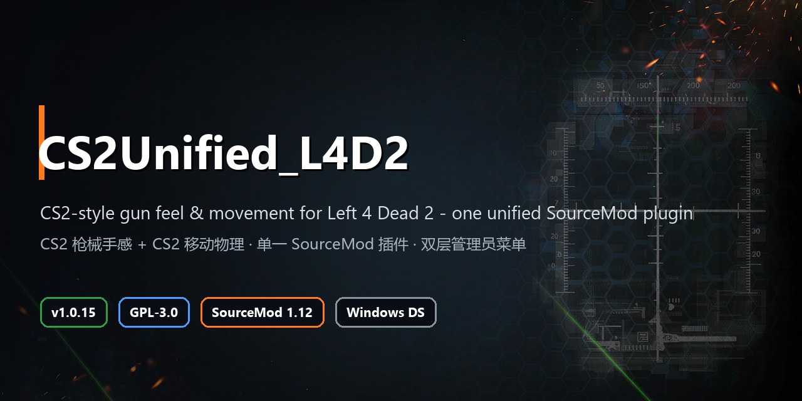

<p align="center"></p>

# CS2Unified_L4D2

**English** | [简体中文](README.zh-CN.md)

> **About this mirror**: this repository is the **public release mirror** of CS2Unified_L4D2, periodically synced from a private development repo. It contains no development history, no runtime-evidence directory (`tests\results\`) and no internal handover documents.
> `<DS_DIR>` / `<DS_HOST>` / `<REPO_ROOT>` / `<CLIENT_DIR>` are path placeholders — replace them with your own dedicated-server root (the directory containing `srcds.exe`), your server address, this repository's root, and your client's `left4dead2` directory.
> You provide the runtime: an L4D2 dedicated server plus SourceMod 1.12 / MetaMod 1.12. Supply the RCON password via the `-Password` parameter or the `CS2U_RCON_PASSWORD` environment variable — **never commit it**.

This project merges **CS2-style gun feel** (cs2feel) and **CS2-style movement physics** (cs2movement) into a **single `cs2unified.smx`**, and adds a unified management layer on top of the two upstream modules:

- a **two-tier admin chat menu** (basic 6 rows / advanced 7 rows, 7 pages, hot-reloadable `menu.cfg`),
- **validated writes for 39 managed parameters** (7 injury-slowdown, 3 crouch-slide, 2 water-slowdown),
- **7 built-in presets** (including a full CS2 simulation and a CS2-recoil + bullet-tracer combo) plus 2 DIY slots,
- KeyValues config persistence / hot reload / rollback,
- **SteamID list > admin group** authentication,
- since 1.0.2, a **client-only** "camera / crosshair separation" detector (Left4Neko's `l4n_view_punch_scale`; the server only detects and guides, never touches ballistics),
- since 1.0.10, a movement-level **survivor slowdown by water depth** (ankle / waist / eye); the infected team is completely unaffected,
- since 1.0.12, an **environment-adaptation page** at the end of the movement section: it measures the actual tick via `GetTickInterval()` and aligns values that only hold at a specific tick — **preview first, then apply, undoable**, and it **never writes `sv_*`**.
- since 1.0.13, the three feel layers (recoil / ballistics / spread) are **team-gated**: only the infected team is skipped; survivors and spectators are byte-for-byte unchanged (`cs2u_feel_survivor_only`, default on).
- 1.0.14 fixed the **unresponsive action buttons** on the environment page and added a client-less row-replay command `sm_cs2u_menusel`; 1.0.15 fixed the **undo-message row counting** after a full menu audit (pure-tier adaptations used to report "0 values").

- Plugin version: **1.0.15** (single artifact `cs2unified.smx`)
- Upstream baselines: **cs2feel 0.5.7-m11** (5 `.sp` files) + **cs2movement 0.5.2** (`CS2Movement_L4D2.public`, 5 `.sp`, including `cs2movement_injury.sp`; locally bumped on 2026-11-01, not tagged)
- Local patch layer: `patches\movement_water\` applies the **0.5.3 water-slowdown** patch at generation time (adds `cs2movement_water.sp` + 3 deterministic insertions); `sync_sources.ps1` uses the same transform for write mode and `-Check` mode, so `verify.ps1` can prove the patch is still in place
- License: **GPL-3.0** (inherited from upstream CS2Movement_L4D2; see [NOTICE](NOTICE) and [LICENSE](LICENSE))
- Static acceptance: `tools\verify.ps1` → **VERIFY PASS (145 checks)**, compile **0 errors, 0 warnings**
- Runtime: multiple smoke rounds on a single-player Windows dedicated server (**23 PASS / 3 UNVERIFIED**, including the H-01/H-02 fixes and re-verification of basic mode / tracers / `cs2_full` / injury slowdown); 1.0.5 additionally ran a **menu-layout dump** (`sm_cs2u_menudump`) and `menu.cfg` rollback / hot-reload verification; 1.0.10 added **water-layer runtime evidence** (`tests\results\water-runtime-*.md`); **no human-client menu click-through verification** has been done

> When documentation and implementation disagree, **`src\` and `tools\` code win**. Every "measured" claim cites a file path or command; anything unverifiable is marked `UNVERIFIED` rather than guessed.

---

## 1. Project positioning

| Question | This project's answer |
|---|---|
| Can both upstream plugins be installed together? | Technically yes, but CS2 feel and movement share `OnPlayerRunCmd`, `sv_*` and the callback namespace; as two separate `.smx` files the callback order is decided by SourceMod and cannot guarantee "feel reads the raw buttons first, movement modifies speed afterwards" |
| What this project does | **Mechanically renames** the 10 upstream files (feel 5 + movement 5) and compiles them into **one `.smx`**; `src\cs2unified.sp` becomes the **only** `myinfo` and the **only** callback exit, with explicitly ordered dispatch |
| Added value | Two-tier chat menu (basic/advanced, 7 pages, `menu.cfg` hot reload) / 39 validated parameters + per-weapon speed details for 18 weapons (menu edit, chat input, instant persist) / 7 presets (incl. `cs2_full` full simulation, `cs2_tracer` tracers) + 2 DIY slots / config persistence / rollback / diagnostics / injury slowdown / **client camera-separation detection** / **SteamID list > group auth**; upstream `cs2feel_*`, `cs2movement_*` ConVar names, command names and feel natives are **completely unchanged** (backward compatible) |
| What it does not do | No rewriting of upstream behavior logic; the load-time data layer (`scripts\weapon_*.txt` inside the VPK) is not hot-switchable; no Linux support; no anti-cheat / VAC evasion |

---

## 2. Current status

| Item | Value | Evidence |
|---|---|---|
| Plugin name / version | `CS2Unified (L4D2)` / `1.0.15` | `src\cs2unified.sp` (`CS2U_VERSION`); DS log `[CS2Unified] LOAD version=1.0.15 feel=0.5.7-m11 movement=0.5.3` |
| Artifact | single `build\cs2unified.smx`, **~160–180 KB** | `tools\build.ps1`; `spcomp` output is **not byte-reproducible** — size drifts and SHA256 differs between builds of the same source → **do not hardcode hashes, trust the current build output** |
| Compile | Code / Data / Stack per current `build.ps1` output; error / warning must be 0 / 0 | `tools\build.ps1` output |
| Source size | **23 `.sp` files** / **15,103 lines** / **573,761 B** | same counting method over `src\` (incl. patch-generated `cs2movement_water.sp`, `cs2u_weapon.sp`, `cs2u_env.sp`) |
| Generated files | `src\feel\` 5 files, `src\movement\` **6 files** (upstream 5 + patch 1, incl. `cs2movement_injury.sp` / `cs2movement_water.sp`) generated by `tools\sync_sources.ps1` | `powershell -File tools\sync_sources.ps1 -Check` → `SYNC-OK 11 files match upstream + rename table + patches` |
| Static acceptance | **145 / 145 PASS** | `powershell -File tools\verify.ps1` → `VERIFY PASS (145 checks)` |
| Compile warnings | 0 errors / 0 warnings (`-StrictWarnings`) | check #2 of `verify.ps1` |
| Runtime smoke | load, status, presets, save/hot-reload, map-change persistence, rollback, bad-config rejection, BOM, console entry, restore, `set→changelevel`, `enable 0` rejects writes, default uninstall, **basic-mode persistence (legacy)**, **`cs2_tracer` apply**, **tracer sprite precache**, **`cs2_competitive` params (36 at 1.0.4; 37 since 1.0.9; 39 since 1.0.10)**, **`managed_params` (39 since 1.0.10)**, **injury-slowdown state (enable=1 / speed=132)**, **water layer (1.0.10: curve / live changes / preset 39 / netprop / menu rows)**: **23 PASS / 3 UNVERIFIED**; UNVERIFIED = human-client menu/paging, whether tracers are actually "visible", low-HP injury-slowdown feel | dev-repo runtime records (conclusions are tabulated in this README and in docs/05) |
| Managed parameters | **39** (`cs2feel_*` 12 + `cs2movement_*` 15 + **`cs2movement_injury_*` 7** + **`cs2movement_water_*` 2** + `cs2u_tracer_*` 3; `cs2u_bmode` belongs to the feel group) | `src\cs2u_params.sp`; `sm_cs2u_status` → `managed_params=39` |
| Built-in presets | **7** + 2 DIY slots (appear after you save them); `cs2_full` / `cs2_competitive` write all **39** values, the rest are semantic subsets that **auto-complete** `cs2u_bmode` and the water keys (`vanilla` 19 / `cs2_matched` 22 / `cs2_split` 22 / `cs2_tracer` 22 / `movement_only` 28) | `src\cs2u_modes.sp`; persisted to `cs2unified.cfg` on the DS |
| Public interface | **107** ConVars (unified layer 12 + feel 35 + **movement 60**), 22 commands, 7 feel natives | legacy audit `_audit_extract.txt` counted 105 / 21 / 7 (now 107 ConVars, missing=0; 1.0.13 added `cs2u_feel_survivor_only`, 1.0.14 added the regression command `sm_cs2u_menusel`) |
| Measured environment | L4D2 `PatchVersion 2.2.4.3`, SourceMod **1.12.0.7230**, MetaMod 1.12, 64 tick (L4DToolZ), `-insecure` dedicated server `<DS_DIR>` | runtime-evidence records are not published with this public repository (see note above) |

### 2.1 Baseline versions (unified)

| Component | Repo source | Online DS binary | Handling |
|---|---|---|---|
| cs2feel | `0.5.7-m11` | `cs2feel_core.smx` **49,201 B**, matches the source's self-declared version | integrated (`CS2F_VERSION "0.5.7-m11"`) |
| cs2movement | `0.5.2` (previous release tag `v0.5.1`) + local patch **0.5.3** | `cs2movement.smx` **0.5.1** (not updated online) | **integrated** (`CS2M_VERSION "0.5.3"`); 0.5.1 introduced `cs2movement_injury.sp`, 0.5.3 adds `cs2movement_water.sp` via the patch layer |

- The merged artifact logs `LOAD version=0.5.3` (0.5.1 measured behavior baseline: `LOAD version=0.5.1`; 0.5.2 only changed the `crouch_slide_time` factory default and diagnostics; 0.5.3 only adds the water layer, touching no other physics path).
- **0.5.3 added water slowdown**: 2 `cs2movement_water_*` ConVars, `factor = 1 - slowdown * m_nWaterLevel/3`, survivors only, applied after the injury cap (see §4.1 and [docs\08](docs/08_水面减速_任务交接.md)).
- **0.5.1 added injury slowdown**: 7 `cs2movement_injury_*` ConVars; default ratio mode `132/220 = 60%`, restoring the classic limp slowdown for 20-HP survivors (otherwise movement rewrites `m_flMaxspeed` every tick and low-HP players run at full CS2 weapon speed).
- Keeps the 0.4.8 `cs2movement_maxspeed` semantics: **per-player speed clamp, default 1000**, no longer pushing the global `sv_maxspeed` down to 320 (which slowed Charger charges); built-in presets all write `1000`.
- The upstream tree is `CS2Movement_L4D2.public`; the older `CS2Movement_L4D2` (0.4.5) and `CS2Feel_L4D2\scripting` (m10) are **no longer used**. The data-layer VPK still needs paired deployment on client and server.

---

## 3. Capability boundaries

**Can do**

- One `.smx` provides both cs2feel (recoil/ballistics/spread runtime layer) and cs2movement (global `sv_*`, per-player run/crouch/air speed, etc.) with unchanged ConVar and command names.
- `!cs2u` opens the **two-tier menu** (basic 6 rows / advanced 7 rows; 7 content rows per page, #8 back/prev page, #9 next page; `!menu`/`!c2u` are NOT intercepted by default — enable with `cs2u_menu_chat_alias 1`). Basic view: presets & modes, gun feel, movement & injury, visuals & crosshair, status, advanced mode. Advanced view adds config & save, DIY, diagnostics and 3 ROOT parameters. The 39 managed parameters are edited with **in-row cycling** (no third-level value page anymore), validated before the ConVar write, and every single-parameter change **persists immediately** (echoes `(persisted)`).
- One-click built-in presets (incl. `cs2_tracer` = `cs2_matched` + server-side tracers); a snapshot is taken automatically before applying, and `sm_cs2u_rollback` restores the pre-apply state and **persists it**. `cs2_matched` / `cs2_tracer` are "**what you see is what you hit**" (recoil 1.0 / ballistics 0 / spread 0). The preset area also has **2 DIY slots** (`diy_advanced` / `diy_simple`, visible after saving). `cs2_split` is a **server-side** separation: it affects all clients, but whether the decal follows the hit depends on whether that client has aim-sync installed (the row notes "server-side separation · decal depends on client aim-sync").
- **Trajectory mode (solo · TR-40 / multiplayer, 2026-11-03)**: `!cs2u` → Gun Feel → "Trajectory mode" row (cycles: auto / solo · TR-40 / multiplayer).
  Solo · TR-40 reproduces the old TR-40 feel: camera 1.00× of the table value, ballistics 2.20×, **measured decal 4.98° above the crosshair** (TR-40 rig: 5.225°), requiring the client `cs2feel_aimsync` `ratio = 1.200000`; multiplayer = server-matched, identical ballistics for every client, no "seen ≠ hit".
  Spec and 13 acceptance items: [`docs/07_弹道模式.md`](docs/07_弹道模式.md).

**Cannot do**

- **No hot-swapping the data layer**: the 7 spread keys in the VPK's `scripts\weapon_*.txt` are **load-time assets**; SourceMod cannot replace them at runtime. Presets only manage runtime ConVars. Data-layer changes require redeploying the VPK and restarting.
- Cannot bypass the `cs2feel_spread_mode 0` prerequisite: the data-layer VPK's `addoninfo.txt` explicitly requires "do not enable the spread module at the same time", otherwise there are two spread sources.
- No **Linux** server support: both gamedata files only have `windows` keys (stated in source and gamedata comments).
- No tick-crossing displacement-level consistency guarantee: some cs2movement layers are **server-side-only corrections**; client prediction still has a cost (see [docs\06_已知限制.md](docs/06_已知限制.md) L6).
- No multi-player / remote / human-client menu or feel verification; performance was statically assessed only, no frame-time profiling.
- **Tracers are purely visual**: server-side `bullet_impact → TE_SetupBeamPoints → TE_SendToAll`, hit registration untouched; off by default, opacity via `cs2u_tracer_alpha` (default 110, 0–255). Whether a human client "sees" them is still UNVERIFIED.
- No game-binary modification, no Valve code or decompiled artifacts, no VAC evasion.

---

## 4. Quick start

### 4.1 Build

Prerequisites: SourceMod 1.12's `spcomp.exe` and its `include\` folder. `tools\build.ps1` lookup order:

1. the `-CompilerPath` parameter;
2. `<DS_DIR>\left4dead2\addons\sourcemod\scripting\spcomp.exe`;
3. a sibling `..\Left 4 Dead 2\left4dead2\addons\sourcemod\scripting\spcomp.exe` (Steam-library layout);
4. `spcomp.exe` on `PATH`.

```powershell
cd <REPO_ROOT>

# sync upstream first (optional: build.ps1 -Sync does this too)
powershell -ExecutionPolicy Bypass -File .\tools\sync_sources.ps1

# compile (-StrictWarnings: any warning fails the build)
powershell -ExecutionPolicy Bypass -File .\tools\build.ps1 -StrictWarnings

# static acceptance (145 checks: sync drift + compile + symbol/interface/menu contracts + team boundaries + script BOM)
powershell -ExecutionPolicy Bypass -File .\tools\verify.ps1
```

Artifact: `build\cs2unified.smx` (~150 KB). **Do not compare sizes/hashes across builds**; `spcomp` output contains non-deterministic content.

### 4.1.1 CI (one command, one exit code)

```powershell
# static gate (~5 s, no server needed): sync drift + compile + 145 contracts
powershell -ExecutionPolicy Bypass -File .\tools\ci.ps1

# full run (static + deploy to test server + water/weapons/env runtime suites, ~4 min; starts/stops srcds itself)
powershell -ExecutionPolicy Bypass -File .\tools\ci.ps1 -Stage Runtime -Force

# a single suite only
powershell -ExecutionPolicy Bypass -File .\tools\ci.ps1 -Stage Runtime -Only water -Force
```

- Artifacts land in `tests\results\ci-<timestamp>\`: `summary.md` / `summary.json` (machine-readable) + `static.log` /
  `deploy.log` + per-suite `<suite>.md` / `<suite>.json` / `<suite>.console.log`.
- The runtime suites carry **assertions**, not just printed evidence: `tests\water_runtime.ps1` (20 checks),
  `tests\weapons_runtime.ps1` (26), `tests\env_runtime.ps1` (31, 64 Hz);
  the 30 Hz leg is `tests\env30_runtime.ps1` (22 checks; temporarily parks `l4dtoolz` / `tickrate_enabler` for a true 30-tick run), **not part of CI by default** (see below).
  Each suite starts the server → asserts → stops it; failures exit non-zero.
- **Close any running local L4D2 client before running the runtime suites**: the client holds the Steam app session and the dedicated server occasionally hangs at map load (process alive, port closed, `console.log` not growing). This is a measured interference, not a plugin bug.
- A running srcds is never silently killed: pass `-Force` to replace it.
- **A hosted CI can only run the static half** (no game files, no Steam-authenticated DS), so the runtime gate stays on your machine behind the unified `tools\ci.ps1` entry; `-CompilerPath/-IncludePath` can point at any SourceMod install.

Git hooks (optional, one-time):

```powershell
powershell -ExecutionPolicy Bypass -File .\tools\install-hooks.ps1        # pre-commit
powershell -ExecutionPolicy Bypass -File .\tools\install-hooks.ps1 -Hook pre-commit,pre-push
powershell -ExecutionPolicy Bypass -File .\tools\install-hooks.ps1 -Uninstall
```

`pre-commit` runs the static gate only (~5 s); skip once with `CS2U_SKIP_CI=1 git commit ...`. Runtime suites are **deliberately not hooked** — they hold a server for minutes.

### 4.2 Deploy

**Stop the server first** (copying fails if the `.smx` / VPK are locked), then:

```powershell
# print the plan only, touch nothing
powershell -ExecutionPolicy Bypass -File .\tools\deploy.ps1 -DryRun

# real deployment (default target <DS_DIR>; auto-backs up to _backup\<timestamp>\)
powershell -ExecutionPolicy Bypass -File .\tools\deploy.ps1

# also disable the test probes cs2f_mv3.smx / cs2f_aimdebug.smx
powershell -ExecutionPolicy Bypass -File .\tools\deploy.ps1 -DisableProbes
```

Notes (details in [docs\04_部署与回滚.md](docs/04_部署与回滚.md)):

- By default `plugins\cs2feel_core.smx` and `plugins\cs2movement.smx` are moved to `plugins\disabled\` — the merged artifact registers the same ConVars/commands; loading both would double-register.
- Every overwritten file is copied to `_backup\<timestamp>\<relative path>` first; `install-manifest.csv` is **appended after every single action** (undo records exist even for a mid-run failure).
- Each deployment also merges `_backup\project-manifest.csv`: **each path keeps the absolute path of its first-ever backup**, so repeated deployments never overwrite the true "pre-project state". Uninstall prefers it by default.
- `-NoAddon` skips the data-layer VPK; `-KeepLegacy` keeps the old plugins enabled (**not recommended**).

### 4.3 Runtime commands

```
sm plugins list                 # expect CS2Unified (L4D2) 1.0.15, no [FAILED]
sm_cs2u_status                  # version / config / presets / 39 params / menu layout / auth / feel / movement summary
sm_cs2u_presets                 # list the 7 presets, [active] marked
sm_cs2u_preset cs2_full         # full CS2 simulation (39/39 managed values), persisted  [ROOT]
sm_cs2u_preset cs2_tracer       # CS2 recoil + bullet tracers (20 params), persisted   [ROOT]
sm_cs2u_preset cs2_matched      # what-you-see-is-what-you-hit (recoil 1.0 / ballistics 0) [ROOT]
sm_cs2u_set cs2feel_recoil_scale 1.5   # validate → write ConVar → persist immediately (echoes (persisted))
sm_cs2u_set cs2u_tracer_enable 1       # enable server-side tracers (visual only)
sm_cs2u_save                    # persist the current 39 params to cs2unified.cfg  [ROOT]
sm_cs2u_save custom             # save as new preset custom (≤12 presets)     [ROOT]
sm_cs2u_reload                  # re-read param config + menu.cfg and apply immediately [ROOT]
sm_cs2u_rollback                # restore the pre-apply snapshot and persist it [ROOT]
sm_cs2u_diag                    # status + gamedata/config paths/signature errors  [ROOT]
sm_cs2u_menudump                # print all 7 menu pages (basic/advanced each) [ROOT]
```

Advanced mode (ROOT):

```
!cs2u                             # basic 6 rows; last row "advanced mode"
# click "advanced mode" → 7 rows: adds config & save, DIY, diagnostics, 3 ROOT params
# click "exit advanced mode" to go back; the mode is not persisted (session-only)
```

Chat entry: **`!cs2u`** (SourceMod natively maps it to `sm_cs2u`). `!menu` / `!c2u` are common namespaces and are **not intercepted by default** (`cs2u_menu_chat_alias 0`) to avoid clashing with other plugins; enable explicitly with `cs2u_menu_chat_alias 1` only when no conflict exists. `!admin` is not taken over — SourceMod's own Admin Menu stays.

> **1.0.15 menu**: basic/advanced views, 7 pages (presets, gun feel, movement & injury, visuals & crosshair, status, config & save + root), in-row parameter cycling; `menu.cfg` hot-reloads with fail-closed fallback + admin notice on validation failure. The movement section ends with two **code-owned three-level pages**: **detailed movement numbers** (root → movement & injury → 18 weapon speeds; click a row, type the value in chat, persists immediately, last row restores defaults in one click) and **environment adaptation** (root → movement & injury → probe / preview / apply / undo). Human-client click-through/paging remains `UNVERIFIED`.

> `sm_cs2u_set` and menu clicks now **persist immediately**: success echoes `OK: <cvar> = <value> (persisted)`; a failed write clearly reports `but persistence failed: <reason>` (memory value changed, disk still old — a map change would revert). Fixed and re-verified (`set 2.4` → `changelevel` → still `2.400`). When `cs2u_enable 0`, these write commands are refused; `status` / `diag` remain read-only.
>
> **What-you-see-is-what-you-hit**: `cs2_matched` (also the built-in default), `cs2_tracer` and `cs2_full` are all recoil 1.0 / ballistics 0 / spread 0; `cs2_split` is a "camera−ballistics separation", not WYSIWYH. A server cfg may set `cs2feel_recoil_scale` to something else — re-apply `cs2_matched` or `cs2_full` to force consistency. The **client-side** camera separation (Left4Neko `l4n_view_punch_scale`) is not part of the presets: the server cannot detect/set it; a client that set k≠1 will have its camera offset by k while bullets/hits/decals stay identical — the client's own choice, see `client\cs2u_client_l4n.cfg`.
>
> **`cs2_full` and sliding**: it explicitly writes all 39 managed values, including `cs2movement_crouch_slide 1`, `crouch_slide_time 0.20`, `crouch_slide_min_speed 100` and `crouch_slide_client 1` (client half-enable: both ends slide; it drives a global cvar, so the plugin gates it to "only one survivor sliding and nobody else crouching", falling back to server-side-only otherwise). This slide approximates **CS2's crouch transition** (momentum kept while running-crouching, exponential decay to crouch speed) — it is **not** a separate "slide skill" from CS2; set `cs2movement_crouch_slide` to 0 for strictly no sliding. See [docs\06_已知限制.md](docs/06_已知限制.md) L20.

### 4.4 Restore

```powershell
# default DRY-RUN: prints what would be deleted/restored
powershell -ExecutionPolicy Bypass -File .\tools\uninstall.ps1

# real rollback: prefers _backup\project-manifest.csv (first backup per path)
powershell -ExecutionPolicy Bypass -File .\tools\uninstall.ps1 -Apply

# undo a single deployment: pass that run's timestamp directory
powershell -ExecutionPolicy Bypass -File .\tools\uninstall.ps1 -Apply -BackupDir .\_backup\20261031-180836
```

- **Default (project-manifest)** = back to "before the project": removes `cs2unified.smx`, moves the 4 legacy plugins (incl. probes) back to `plugins\`, deletes the runtime config directory if it only holds `cs2unified.cfg(.bak)`.
- **Single run (`-BackupDir`)** = only undoes that one deployment's actions — good for stepping back one deploy, not for a full uninstall.
- Restart srcds after restoring; the script prints `UNINSTALL manifest=...` and per-line actions (15 lines measured).

---

## 5. Command reference

| Command | Registration | Description |
|---|---|---|
| `sm_cs2u` / `sm_cs2u_menu` | `RegConsoleCmd` (checks `ADMFLAG_GENERIC` internally) | open the menu; server console invocation reports client-only |
| `sm_cs2u_status` | `ADMFLAG_GENERIC` | unified-layer / config / feel / movement status |
| `sm_cs2u_presets` | `ADMFLAG_GENERIC` | preset list |
| `sm_cs2u_set <cvar> <value>` | `ADMFLAG_GENERIC` (3 ROOT params refused per-item inside the command) | single-parameter write: validate → write ConVar → persist immediately |
| `sm_cs2u_preset <name>` | `ADMFLAG_ROOT` | apply preset + snapshot + persist |
| `sm_cs2u_save [preset]` | `ADMFLAG_ROOT` | save settings / overwrite or create a preset |
| `sm_cs2u_reload` | `ADMFLAG_ROOT` | re-read config (keeps previous on failure) |
| `sm_cs2u_rollback` | `ADMFLAG_ROOT` | roll back to the preset snapshot and persist |
| `sm_cs2u_diag` | `ADMFLAG_ROOT` | diagnostics output |

Upstream commands kept as-is: `sm_cs2feel_status|reload|verify|spreadtest|recoiltest|ballisticstest`, `sm_cs2movement_status|apply|unapply|reload|selftest`.

> Permissions match the menu: `sm_cs2u_set` registers as `ADMFLAG_GENERIC` with the 3 ROOT parameters (`cs2movement_maxspeed` / `weapon_speed_mode` / `base_speed`) refused per-item inside `Cmd_Set`. Menu and commands share the same `CS2U_IsAdmin` / `CS2U_IsRoot` checks. See [docs\02_菜单结构.md](docs/02_菜单结构.md) §4.

---

## 6. Repository layout

```text
CS2Unified_L4D2\
├─ README.md                     # this file (English)
├─ README.zh-CN.md               # 简体中文说明
├─ NOTICE                        # third-party components, provenance & modifications
├─ LICENSE                       # GPL-3.0 (byte-identical copy of the upstream license)
├─ docs\                         # 00~09 design & ops documents
├─ src\
│  ├─ cs2unified.sp              # the only myinfo + the only callback exit + dispatch order
│  ├─ cs2u_shared.sp             # unified-layer globals/constants
│  ├─ cs2u_params.sp             # the 39-entry managed-parameter table (feel/movement/injury/water/tracer)
│  ├─ cs2u_weapon.sp             # 18-weapon speed table: menu page + chat input + persist
│  ├─ cs2u_core.sp               # lifecycle, permissions, logging, command registration, status, chat aliases
│  ├─ cs2u_config.sp             # KeyValues read/write, validation, .bak, snapshot/rollback
│  ├─ cs2u_modes.sp              # 7 built-in presets (incl. cs2_tracer/cs2_full), atomic apply
│  ├─ cs2u_menu.sp               # two-tier menu (7 pages + #8/#9) and its handlers
│  ├─ cs2u_layout.sp             # menu.cfg parsing/validation/default layout/hot reload
│  ├─ cs2u_auth.sp               # SteamID > group auth + AUTH-* logs
│  ├─ feel\                      # [generated] cs2feel 0.5.7-m11, 5 files
│  └─ movement\                  # [generated] upstream 0.5.2, 5 files + patch 0.5.3: cs2movement_water.sp
├─ tools\
│  ├─ sync_sources.ps1           # upstream → src\ mechanical rename (-Check for acceptance)
│  ├─ build.ps1                  # spcomp compile; -Sync / -StrictWarnings
│  ├─ verify.ps1                 # static acceptance (145 checks)
│  ├─ ci.ps1                     # static + deploy + runtime suites, one exit code
│  ├─ deploy.ps1                 # backup + install + disable legacy plugins + manifest
│  ├─ uninstall.ps1              # manifest-based restore (dry-run by default, -Apply executes)
│  └─ package.ps1                # self-contained release zip (dist\)
├─ tests\
│  ├─ rcon.ps1                   # a correct Source RCON client (EXEC=2)
│  ├─ lib\ds_harness.ps1         # shared runtime-suite rig (env-injected DS dir/host/password)
│  └─ *_runtime.ps1              # water / weapons / env / env30 runtime suites
├─ configs\
│  ├─ cs2feel\                   # weapons.cfg / native_baseline.cfg / punch_sequences.cfg / presets\
│  ├─ cs2movement.cfg            # movement AutoExecConfig template
│  ├─ cs2movement_weapons.cfg    # weapon speed table (18 entries)
│  └─ cs2unified\cs2unified.cfg  # unified-layer config (schema/version/active_preset/presets/settings)
├─ gamedata\                     # l4d2_cs2feel.txt / cs2movement.txt (Windows-only)
├─ addon\
│  ├─ addoninfo.txt              # data-layer VPK metadata source (908 B)
│  └─ cs2feel_r2_plugin.vpk      # data-layer VPK, 85,318 B
├─ client\                       # client-side cfgs handed to players
├─ patches\                      # deterministic source patches applied at sync time
└─ build\cs2unified.smx          # build artifact (excluded via .gitignore)
```

`_backup\<timestamp>\` and `tests\results\` are created by the tools locally and are excluded from the repository.

---

## 7. Compatibility

| Item | Requirement | Basis |
|---|---|---|
| Game | Left 4 Dead 2, **Windows** (listen or dedicated) | gamedata only has `windows` keys |
| Game build | `PatchVersion 2.2.4.3`, `server.dll` 9,130,288 B, SHA256 `A93EC916A8F26FBEA85688C321D2BA8DD346D435FAB09A0B926DD950C2E1EA12` | `gamedata\l4d2_cs2feel.txt` header; all three `cs2movement.txt` signatures bind to the same build |
| SourceMod | **1.12** (measured `1.12.0.7230`, compiler `spcomp 1.12.0.7210`) | DS measurements; `build.ps1` prefers that DS's compiler |
| MetaMod:Source | 1.12 | DS measurements |
| DHooks | required (three engine-level detours in movement) | auto-degrades to global `sv_*` only when missing, no crash |
| Tickrate | 30 tick default; 64 tick needs **L4DToolZ + tickrate enabler** | measured DS boot log `[L4DToolZ] tickrate: 64`; upstream D8 |
| Linux | **not supported** | both gamedata files lack `linux` keys; feel fails closed |
| Data layer | client and server need the **same** `cs2feel_r2_plugin.vpk` | load-time asset; mismatch splits presentation between ends |

---

## 8. Known limitations (summary)

1. **Value changes now persist immediately (H-01 fixed & re-verified)**: menu / `sm_cs2u_set` writes sync to disk and echo `(persisted)`; a failed write is clearly reported and a map change would then revert. The write-failure path itself was code-reviewed, not fault-injected on real disk failures.
2. **The data layer is not hot-switchable**: the VPK's `scripts\weapon_*.txt` only applies at load time; presets cover runtime ConVars only.
3. **Baselines are unified**: the merge uses `CS2Movement_L4D2.public` current source (movement 0.5.2, locally bumped 2026-11-01, untagged; last release tag `v0.5.1`); the online binary is still 0.5.1; the data-layer VPK still needs paired client/server deployment.
4. **No human-client verification**: menu click-through, the optional `!menu` alias and basechat interaction (off by default), multi-player/remote feel and prediction-error behavior are unverified.
5. **Windows-only + bound to a single game build**: after a game update the signatures must be re-scanned, otherwise the engine layer fails closed.
6. **Some movement layers are server-side-only corrections** (`air_jump_speed`, `lowspeed_sustain`, `crouch_slide`, etc.); client prediction still has a cost — do not treat this as a zero-cost CS2 restoration.
7. **Config corruption handling is fail-closed**: whole-file rejection keeping the previous version; on startup, a missing/rejected main file is restored once from `.bak` (`CONFIG-RESTORED/RECOVERED-FROM-BAK`). The crash window and disk-write failures were not individually fault-injected; >32 KiB truncation behavior is also untested.
8. **Tracers are visual-only and off by default**: the server draws a beam for all clients, hit registration untouched; a missing sprite becomes a no-op (logs `TRACER-SPRITE-MISSING`). Human "can I see the tracer" is unverified.
9. **Advanced mode is visibility-only**: it only controls whether ROOT/rare rows render and grants no permissions; ROOT actions are re-checked inside their handlers. `cs2u_simple_mode` is a legacy compatibility ConVar; the 1.0.5 menu no longer switches views based on it.
10. **`cs2_full` covers the 39 managed values**: engine cvars outside the unified layer (`sv_accelerate` etc.) remain owned by `cs2movement.cfg` / upstream defaults; its "full simulation" is the CS2-closest setting of those managed values, not per-item engine equivalence.
11. **`cs2_full`'s slide is an approximation**: `cs2movement_crouch_slide 1` approximates the CS2 crouch transition (exponential momentum decay) — it is **not** a standalone CS2 slide skill; set it to 0 for strictly no sliding.
12. **Injury slowdown relies on the server rewriting speed every tick**: client prediction/lag compensation still applies; the human low-HP feel is unverified (`injury_enable=1`, ratio 132/220).
13. **Uninstall restores via `project-manifest.csv` by default** (H-02 fixed & re-verified: 4 `ALREADY-DISABLED`, a 15-line manifest, legacy restored, runtime config cleaned); `-BackupDir` only undoes a single deployment. A hard process kill between actions was not simulated.
14. **Licensing**: cs2feel is the **project owner's own work** (confirmed 2026-11-08) and ships with this project under GPL-3.0; the cs2movement side is explicitly GPL-3.0. Third-party provenance and modifications are documented in [NOTICE](NOTICE) §5; the data-layer VPK contains modified Valve weapon scripts — confirm redistribution compliance yourself (NOTICE §5.3).

Full version: [docs\06_已知限制.md](docs/06_已知限制.md).

---

## 9. Document index

| Document | Contents |
|---|---|
| [docs\00_整合设计.md](docs/00_整合设计.md) | module responsibilities (incl. `cs2u_visual.sp`), callback dispatch order and rationale, fail-closed design, why a single `.smx` |
| [docs\01_符号映射表.md](docs/01_符号映射表.md) | the 14 + 19 rename table, conflict list, preserved public interface, upstream upgrade flow |
| [docs\02_菜单结构.md](docs/02_菜单结构.md) | two-tier menu tree, info ids, auth, menu.cfg, hot reload, feedback & acceptance |
| [docs\03_配置schema.md](docs/03_配置schema.md) | KeyValues schema, validation rules, save/reload/rollback/BOM, capacity limits |
| [docs\04_部署与回滚.md](docs/04_部署与回滚.md) | build prerequisites, artifact list, why legacy plugins are disabled, backups/manifest, uninstall rollback, VPK pairing |
| [docs\05_测试清单.md](docs/05_测试清单.md) | the static checks one by one, compile sizes, runtime commands and measured results, unverified items |
| [docs\06_已知限制.md](docs/06_已知限制.md) | all limitations and risks in engineering terms |
| [docs\07_弹道模式.md](docs/07_弹道模式.md) | trajectory-mode (solo · TR-40 / multiplayer) spec and acceptance |
| [docs\08_水面减速_任务交接.md](docs/08_水面减速_任务交接.md) | water-slowdown layer handover |
| [docs\09_一键适配本机环境_任务交接.md](docs/09_一键适配本机环境_任务交接.md) | environment-adaptation page handover |

---

## 10. License & attribution

- This project is released under **GNU GPL-3.0** (inherited from upstream CS2Movement_L4D2). Full text in [LICENSE](LICENSE), **a byte-identical copy of the upstream license** (35,147 B, SHA256 `8CEB4B9E…`), unmodified.
- Provenance and modification details in [NOTICE](NOTICE): where cs2feel / cs2movement come from, this project's mechanical renames and new unified layer, and the attribution of SourceMod and DHooks.
- SourceMod / MetaMod / DHooks are published by AlliedModders and its contributors under GPL-3.0; this project **does not bundle** their binaries (DHooks must be installed separately).
- Left 4 Dead 2, Counter-Strike 2 and Source are trademarks of Valve Corporation; this project is unaffiliated with and not endorsed by Valve or AlliedModders.
